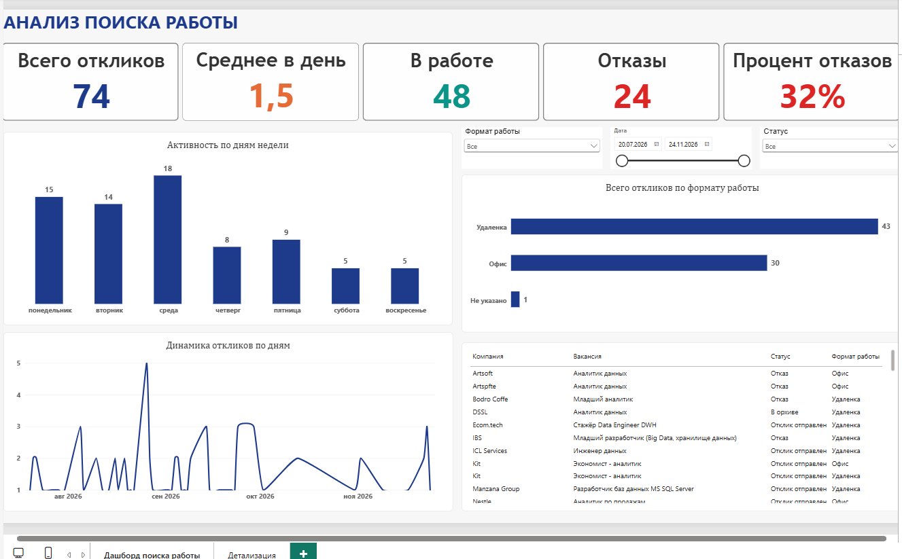
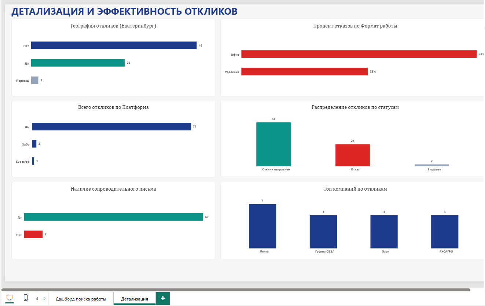

# Анализ эффективности поиска работы

Дашборд в Power BI, созданный на основе данных о 53 откликах на вакансии аналитика данных.

## 🎯 Цель проекта
Проанализировать эффективность поиска работы, выявить закономерности и скорректировать стратегию.

## 📊 Что показывает дашборд

### Страница 1: Общая картина
- **KPI-карточки:** всего откликов (74), в работе (48), отказы (24), % отказов (32%), среднее в день (1.5)
- **Динамика по дням недели** (среда — самый активный день)
- **Динамика по датам** (пик в сентябре)
- **Распределение по формату** (удалёнка — 58%)
- **Таблица с деталями** по каждой вакансии

### Страница 2: Детализация
- **География** (Екатеринбург — 26%)
- **Платформы** (HH — 95%)
- **Распределение откликов по статусам** (Отклик отправлен - 48)
- **Топ компаний** по количеству откликов

## 📈 Ключевые выводы
- Удалёнка — 58% откликов
- Среда — самый активный день
- 32% отказов
- HH — основная платформа (95%)

## 🛠️ Инструменты
- Power BI (DAX, меры, визуализация)
- Google Sheets (источник данных)

## 📁 Файлы
- 
- 

## 📬 Контакты
- GitHub: [Stepa555](https://github.com/Stepa555)
- Email: stepan.apsalyamov@gmail.com
- Telegram: @Stepap445
